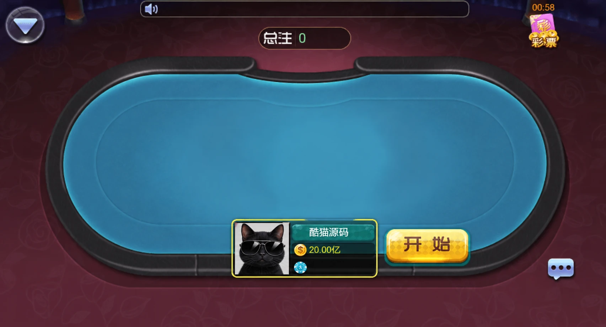
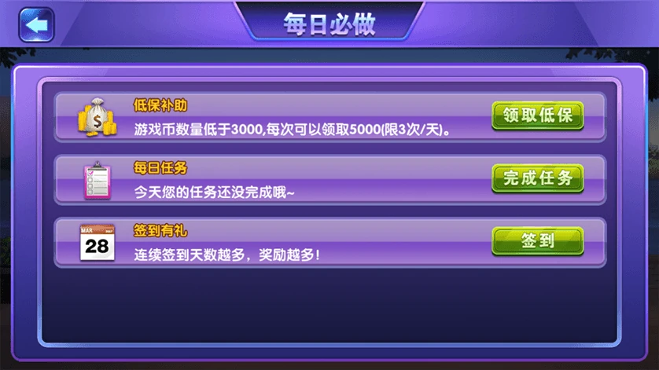

# 双娱版：客户端组成与房间状态同步

双娱版采用网狐荣耀内核，配套平台服务端、Android与iOS客户端、前台网站及数据库。游戏入口分为帕斯场与百人场，大厅提供公告、好友、排行榜和设置等页面。

## 大厅


## 房间



## 每日任务



大厅与房间图的账号信息已作示例化处理，采用AI编辑。文章聚焦界面状态管理，配图中原有金币、VIP及彩票入口不代表已经被移除，也不作为本文的接入功能。

## 状态同步

客户端可能先收到较新的状态，再收到延迟的旧消息。若每次都直接覆盖界面，已经开始的房间可能重新显示等待按钮。一个简单的处理方法是为每个房间的快照增加递增版本号，只接受比当前版本更新的消息。

下面是独立JavaScript示例。`roomId`区分房间，`version`表示更新顺序，`phase`只演示等待、进行中和关闭三种显示状态，不是原项目协议。

```js
// 独立教学示例，不是双娱原始源码。
export function applySnapshot(current, incoming) {
  if (!incoming || typeof incoming.roomId !== 'string' || !incoming.roomId.trim())
    throw new TypeError('房间标识无效');
  if (!Number.isSafeInteger(incoming.version) || incoming.version < 0)
    throw new TypeError('版本号无效');
  if (!['waiting', 'playing', 'closed'].includes(incoming.phase))
    throw new TypeError('状态无效');
  if (current && current.roomId !== incoming.roomId)
    throw new Error('不同房间不能合并');
  if (current && incoming.version <= current.version) return current;
  return {roomId:incoming.roomId, version:incoming.version, phase:incoming.phase};
}
```

当前版本为2时，版本1与版本2的消息均被忽略；版本3才更新画面。切换房间前需要清空旧房间状态，否则函数会拒绝不同房间的混合消息。

版本号应由可信服务端产生。若服务端重启会重置计数，还需要增加会话标识或重新获取完整快照，不能只比较一个失去上下文的整数。相同版本内容冲突应记录异常并重新同步，而非用最后到达的消息猜测结果。

## 运行示例

实现见 [snapshot.mjs](snapshot.mjs)，测试见 [test.mjs](test.mjs)。安装Node.js后运行：

```sh
node test.mjs
```

测试覆盖乱序消息、重复版本、新版本、房间不匹配、非法字段及对象隔离，共8项断言。此示例不实现发牌、下注、开奖、资金或支付接口。

## 技术交流

[Telegram @root4433](https://t.me/root4433)
